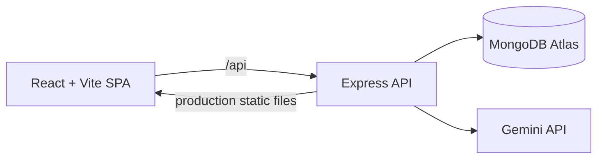

# PrepSense

PrepSense is an AI mock-interview and campus-placement readiness platform. Students choose a company, role, category, difficulty, and question mode, then get structured feedback and track progress across practice sessions.

**Live demo:** pending Render deployment.  
**Screenshots:** to be added after the live UI is verified.

## Project materials

- [Postman API smoke collection](postman/PrepSense.postman_collection.json)
- [Project interview answers and resume bullets](docs/PROJECT_INTERVIEW_ANSWERS.md)
- Demo walkthrough: pending a deployed URL and recorded run.
- Privacy note: PrepSense stores account credentials as bcrypt hashes and practice sessions in MongoDB. Do not include secrets in answers. Public reports contain a sanitized session summary and can be revoked by the owner. Contact the project owner to request account or data removal.

## Features

- Interview categories: DSA, system design, core subjects, and behavioral.
- Written, multiple-choice, and mixed sessions. DSA prompts include problem statements, examples, formats, constraints, and glossary entries when available.
- Gemini question generation and answer evaluation. Multiple-choice answers are scored locally.
- Subjective questions may be reused across students for 24 hours when company, role, difficulty, count, and category match.
- Session history, readiness analytics, topic trends, recommendations, masked company leaderboards, and revocable public reports.
- Admin statistics page for accounts with admin access.

Company topic insights and recommendations summarize questions generated in PrepSense sessions. They are not based on verified company interview records and should not be described as predictions of what a company will ask.

## Architecture



The API uses JWT authentication, bcrypt password hashing, request validation, Helmet security headers, and per-user generation/evaluation limits. Production serves the built SPA from the same Express service.

## Stack

- Node.js 20+, Express 5, Mongoose 9, MongoDB Atlas
- React 19, Vite 7, React Router 7, plain CSS
- `@google/genai`; defaults are `gemini-2.5-flash-lite` for generation and `gemini-2.5-flash` for evaluation

Gemini model IDs can be configured with `GEMINI_QUESTION_MODEL` and `GEMINI_EVAL_MODEL`. Google currently lists these IDs as stable, while noting that access to Gemini 2.5 models is limited for new projects. Exact request limits depend on the Google AI Studio project and tier; check its Rate Limit page before launch.

## Run locally

```bash
npm install
cp .env.example .env
# Set MONGO_URI, JWT_SECRET, and GEMINI_API_KEY in .env
npm run dev
```

`npm run dev` starts Express on port 5000 and Vite on port 5173. Run the unit tests with `npm test`; create a production bundle with `npm run build`.

## Environment variables

See [.env.example](.env.example). Required at server startup: `MONGO_URI`, `JWT_SECRET`, and `GEMINI_API_KEY`.

`DNS_OVERRIDE=1` opts into Google DNS servers for environments whose resolver cannot resolve Atlas SRV records. Leave it unset on Render unless the platform resolver requires it.

## Render deployment

Use one Node web service connected to the `main` branch:

- Build: `npm install --include=dev && npm run build`
- Start: `npm start`
- Health check: `/api/health` (returns database connection state)
- Environment: `NODE_ENV=production`, `MONGO_URI`, `JWT_SECRET`, and `GEMINI_API_KEY`; set `CLIENT_URL` only if the browser client is hosted on a separate origin.

Before connecting Render, use a dedicated Atlas database user with `readWrite` access to the PrepSense database. Configure Atlas Network Access for the Render service and review the old `shareToken_1` index migration. The server drops the legacy sparse index and creates the new partial unique index during startup.

## API

| Method | Endpoint | Access | Purpose |
|---|---|---|---|
| POST | `/api/auth/register`, `/api/auth/login` | Public, rate limited | Create account or sign in |
| GET/PATCH | `/api/auth/me` | Signed in | Read or update profile |
| PUT | `/api/auth/me/password`, `/api/auth/me/deactivate` | Signed in | Change password or deactivate account |
| POST/GET | `/api/sessions` | Signed in | Create a session or list lightweight history |
| GET | `/api/sessions/:id` | Signed in | Read a session |
| DELETE | `/api/sessions/:id/empty` | Signed in | Remove an empty session after question generation fails |
| POST/DELETE | `/api/sessions/:id/share` | Signed in | Create or revoke a report link |
| POST | `/api/questions/generate` | Signed in, rate limited | Generate a round |
| POST | `/api/answers/evaluate` | Signed in, rate limited for written answers | Score an answer |
| POST | `/api/answers/:sessionId/:answerId/retry` | Signed in, rate limited for written answers | Retry a failed evaluation |
| GET | `/api/analytics/overview`, `/api/recommendations` | Signed in | Read analytics and practice recommendations |
| GET | `/api/companies/:name/insights` | Public | Read aggregated PrepSense question-topic data |
| GET | `/api/leaderboard/:company` | Signed in | Read the company leaderboard |
| GET | `/api/admin/stats` | Admin | Read platform statistics |
| GET | `/api/public/report/:token` | Public | Read a sanitized shared report |
| GET | `/api/health` | Public | Check server and MongoDB status |

## Verification

```bash
npm test
npm run build
npm audit --omit=dev
```
