

  
  <h1>PrepSense</h1>
  
AI-powered mock interviews and readiness analytics for campus placements

  

    
    
    
    
    
    
    
    
    
  

  

    <a href="#live-demo">Live demo</a> |
    <a href="#features">Features</a> |
    <a href="#screenshots">Screenshots</a> |
    <a href="#architecture">Architecture</a> |
    <a href="#api">API</a> |
    <a href="#run-locally">Run locally</a> |
    <a href="#license">License</a>
  

<strong>On this page</strong> · <a href="#how-the-readiness-score-works">Readiness score</a> · <a href="#technology-stack">Technology stack</a> · <a href="#environment-variables">Environment</a> · <a href="#deploy-to-render">Deploy</a> · <a href="#security-notes">Security</a> · <a href="#author">Author</a>

## Live demo

<a href="https://prepsense-mhnn.onrender.com/"><strong>Open PrepSense</strong></a>

The live demo runs on a free hosting tier. After a period of inactivity, the first request can take up to a minute while the service wakes.

No demo account is published: create your own free account on the sign-up page.

## Hero screenshots

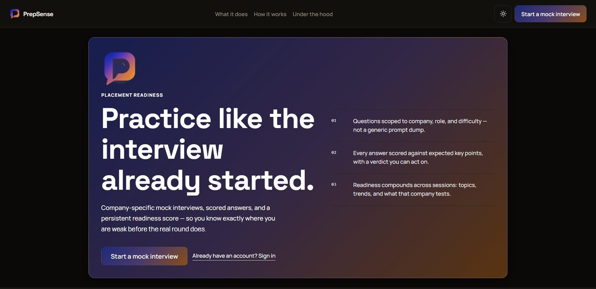

Landing page and product overview.

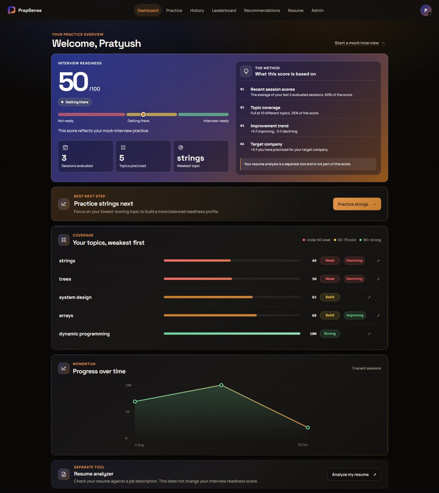

Readiness, topic coverage, and progress over time.

## Features

PrepSense helps candidates practice company- and role-specific interviews, review structured answer feedback, and follow readiness and topic trends over time. It brings written, multiple-choice, and mixed interview modes together with a separate resume analyzer link.

- Generate questions scoped by company, role, difficulty, and category. Subjective question sets are shared by matching practice settings and cached for 24 hours.
- Practice written answers, multiple-choice questions, or mixed sets. DSA prompts include a problem statement, examples, and constraints.
- Review answer scores and feedback such as strengths, improvements, missed points, explanations, and verdicts.
- Track difficulty-adjusted scores, readiness, topic breakdowns, and trends.
- Get recommendations based on weaker personal topics and company practice topics.
- Browse a company leaderboard with masked names and a “You” label for your own entry.
- Review and delete practice sessions; create revocable public report links.
- Export profile data, deactivate or permanently delete an account, and access an admin statistics page with admin authorization.
- Open the separate resume analyzer app from the Resume page.

## Screenshots

<table>
  <tr>
    <td width="50%">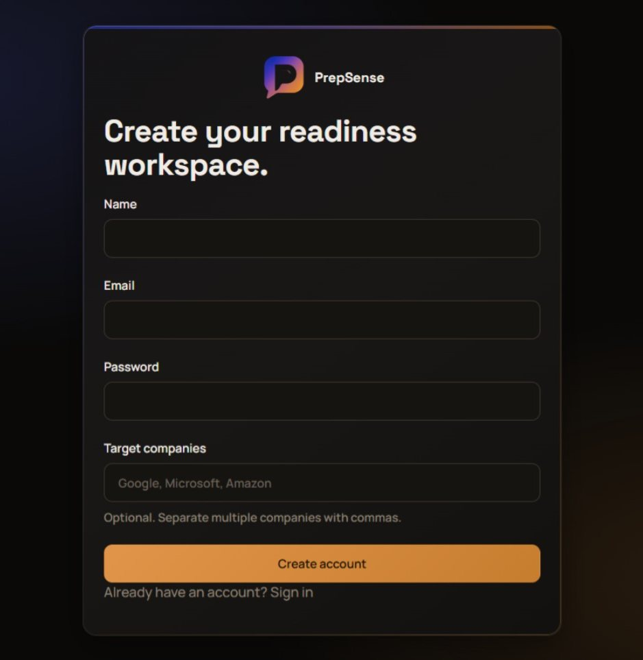
Create an account and choose target companies.
</td>
    <td width="50%">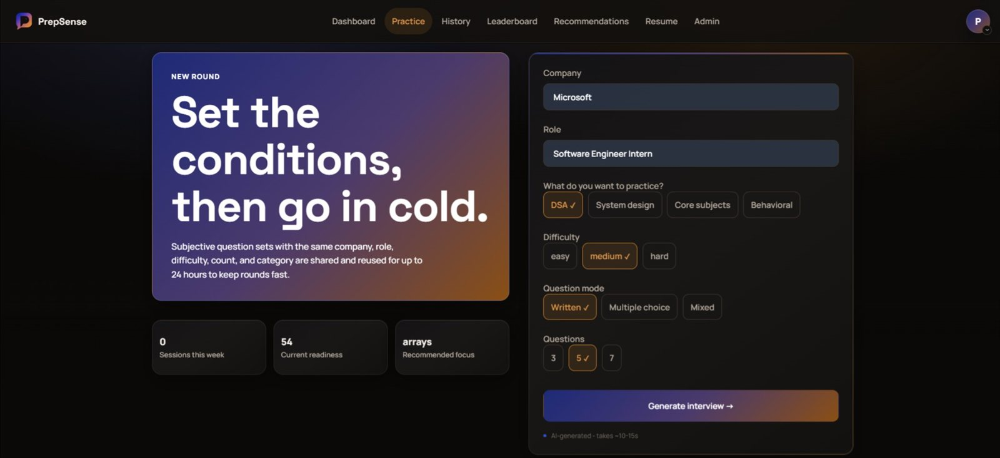
Choose practice settings before generating questions.
</td>
  </tr>
  <tr>
    <td width="50%">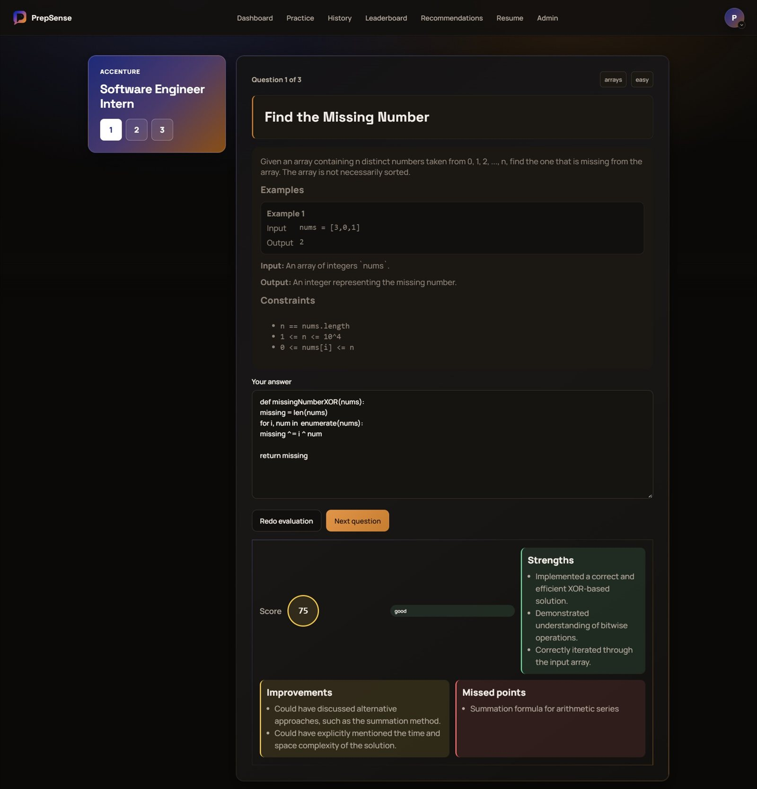
Written practice with score and feedback panels.
</td>
    <td width="50%">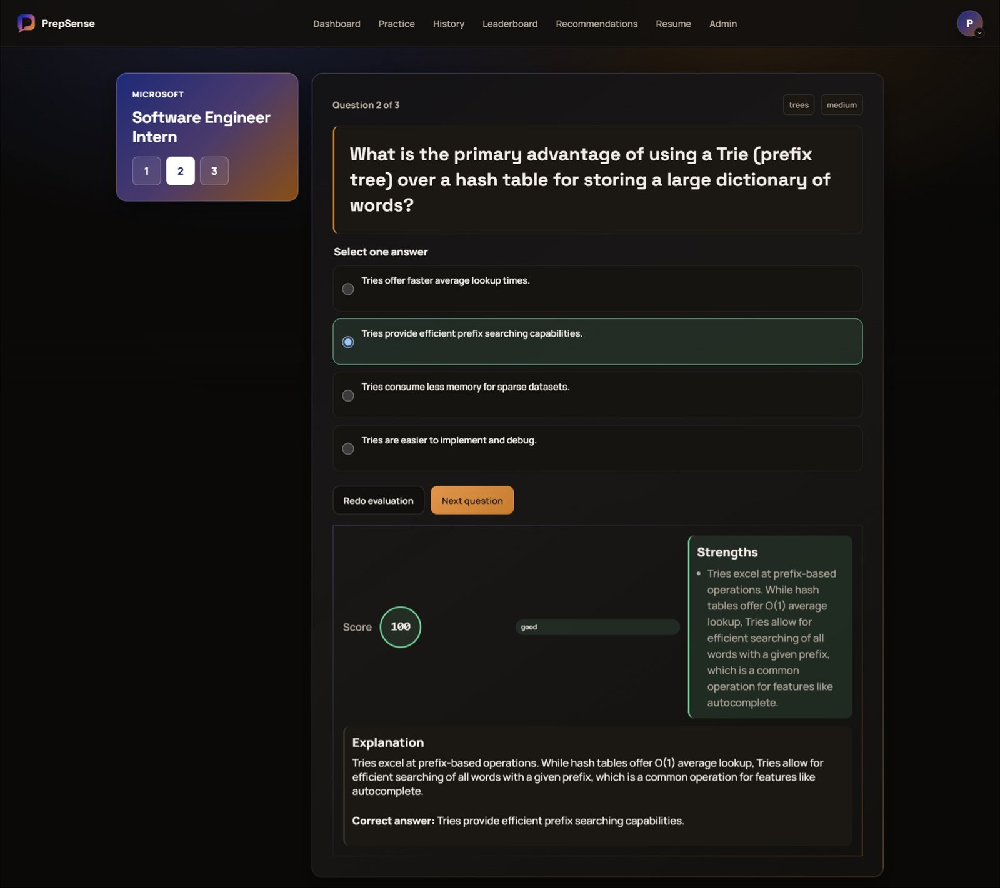
Multiple-choice practice with explanation.
</td>
  </tr>
  <tr>
    <td width="50%">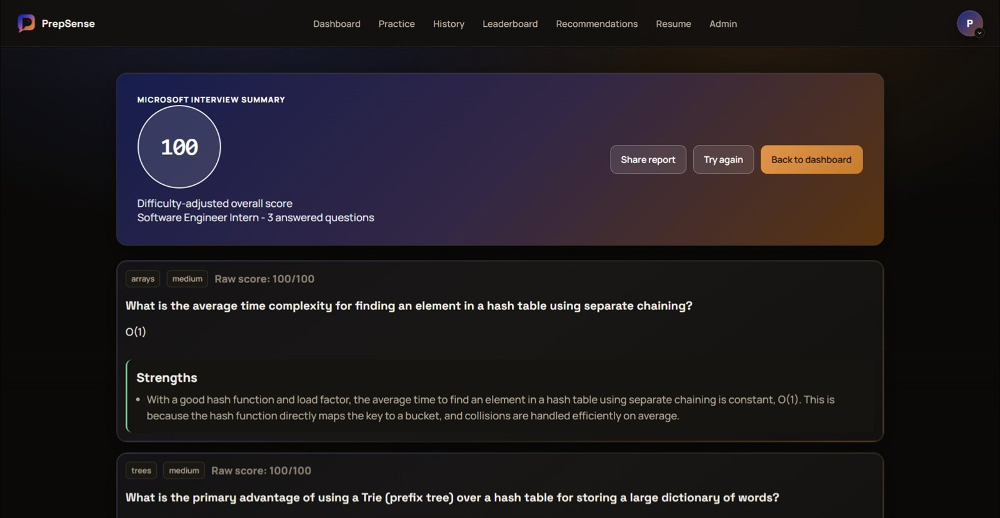
Review a completed interview summary.
</td>
    <td width="50%">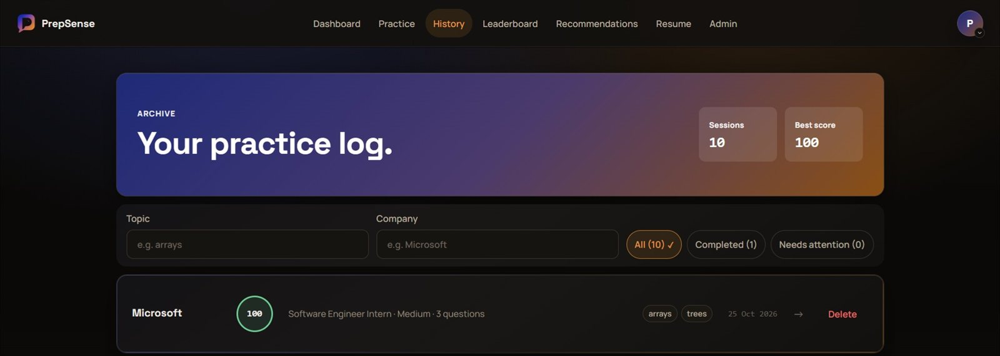
Filter and revisit practice history.
</td>
  </tr>
  <tr>
    <td width="50%">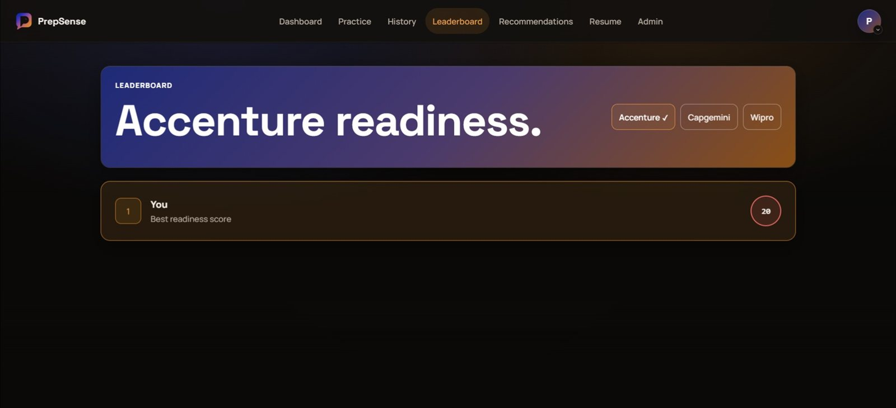
Compare readiness on a company leaderboard.
</td>
    <td width="50%">
Review readiness, topic coverage, and score history.
</td>
  </tr>
</table>

  
Admin view

  
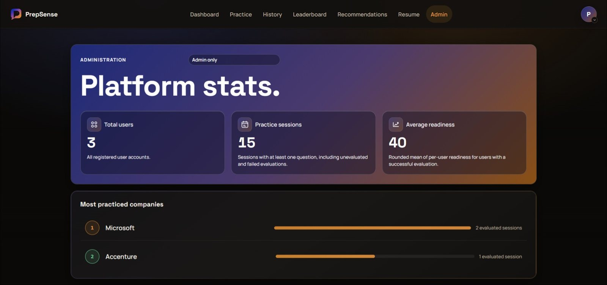

  
Admin-only platform statistics.

  
More screens

  
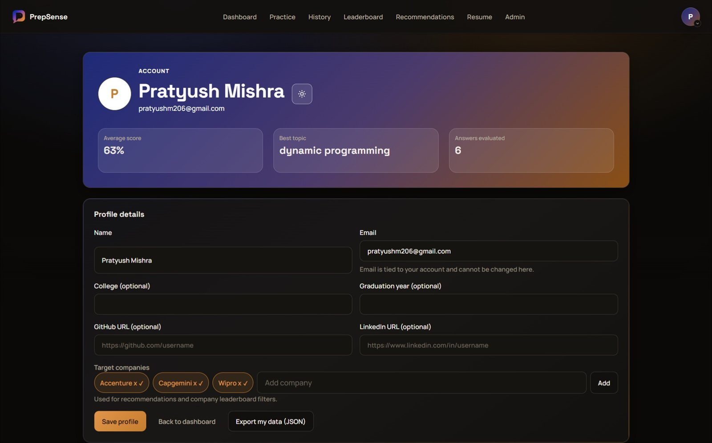

  
Manage profile details and account actions.

  
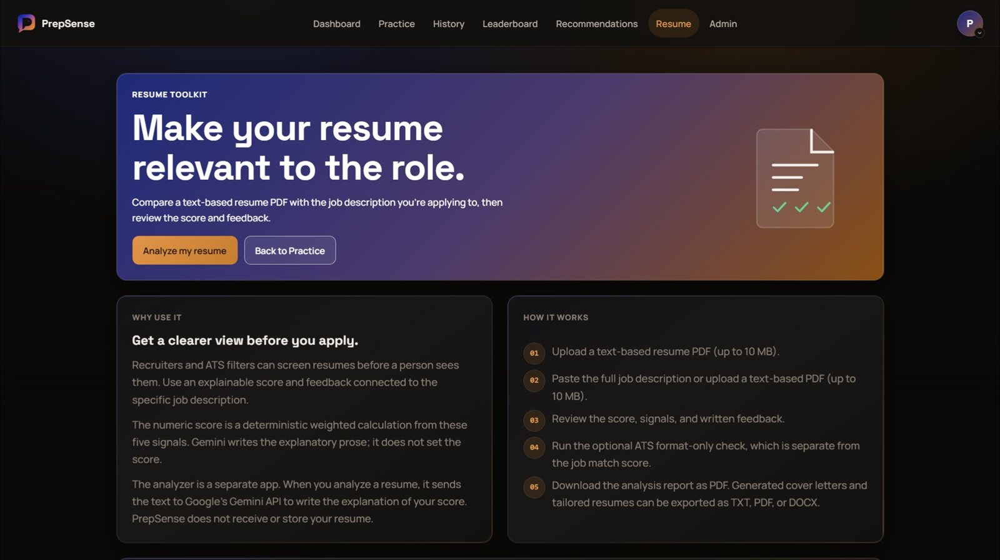

  
Open the separate resume analyzer from the Resume page.

## How the readiness score works

The readiness calculation uses evaluated session scores and topic coverage, then applies trend and target-company adjustments.

| Component | Calculation |
|---|---|
| Recent session scores | Average of the five most recent evaluated session scores, weighted at 60%. |
| Topic breadth | Up to 25%; topic coverage reaches full marks at ten distinct topics. |
| Trend | Add 5 for an improving trend, subtract 5 for a declining trend, or add nothing when stable. |
| Target company | Add 5 when at least one evaluated session matches the target company. |
| Final score | Round and clamp the result to the 0–100 range. No evaluated sessions returns 0. |

Resume analysis is a separate tool and is not part of the readiness score.

## Architecture

~~~mermaid
flowchart LR
  Browser["Browser React and Vite SPA"]
  Server["Express server serving dist and REST API"]
  Database[("MongoDB Atlas")]
  Gemini["Google Gemini API"]
  Resume["Separate resume analyzer app"]

  Browser -->|"REST API requests"| Server
  Server -->|"Database queries"| Database
  Server -->|"Question generation and answer evaluation"| Gemini
  Server -->|"Serves the built frontend"| Browser
  Browser -->|"External link"| Resume
~~~

### Answer evaluation

~~~mermaid
sequenceDiagram
  participant Browser
  participant API as Express API
  participant Gemini as Google Gemini
  participant Validator as Response validator
  participant Scoring as Scoring engine
  participant Database as MongoDB Atlas

  Browser->>API: Submit written answer
  API->>Gemini: Request evaluation
  Gemini-->>API: Structured response
  API->>Validator: Validate response structure
  alt First response is invalid
    API->>Gemini: Retry with stricter JSON prompt
    Gemini-->>API: Retry response
    API->>Validator: Validate retry response
  end
  Validator-->>API: Valid evaluation
  API->>Scoring: Calculate session score
  Scoring-->>API: Difficulty-adjusted score
  API->>Database: Save answer and updated score
  Database-->>API: Saved session
  API-->>Browser: Return evaluation
~~~

## Technology stack

| Layer | Technology | Notes |
|---|---|---|
| Frontend | React 19, React Router 7, Vite 7 | Single-page application with responsive CSS. |
| API | Node.js 20 or newer, Express 5 | REST endpoints and production static hosting for dist/. |
| Database | MongoDB Atlas, Mongoose 9 | Document storage and model validation. |
| AI | Google Gemini via @google/genai | Question generation and written-answer evaluation. |
| Security | bcryptjs, JSON Web Tokens, Helmet, express-rate-limit | Password hashing, authentication, HTTP headers, and request limits. |
| Tests and lint | Node.js node:test, ESLint | Automated tests and static lint checks. |
| Hosting | Render | Web service described by render.yaml. |

## Engineering highlights

- Gemini prompts request structured JSON; response validators reject malformed output and retry once with stricter instructions.
- Subjective question sets use a shared cache keyed by practice settings and expire after 24 hours; multiple-choice sets are generated fresh.
- Scoring normalizes answers by question difficulty; readiness combines recent scores, topic coverage, trend, and target-company practice.
- AI-generation, evaluation, retry, login, and registration routes use rate limiters.
- Helmet sets a Content Security Policy; scripts default to same-origin, while styles and fonts include the configured Google Fonts origins.
- Production startup validates required environment variable names and the minimum JWT secret length.
- Passwords are hashed with bcryptjs, requests use JWT authentication, and admin access is checked against the current database record.
- The account supports data export, deactivation, and permanent deletion. The ci.yml GitHub Actions workflow runs install, test, lint, and build checks; npm test currently reports 24 passing tests.

## Project structure

~~~text
.
├── .github/workflows/   CI workflow
├── config/              Database and runtime configuration
├── controllers/         REST request handlers
├── docs/                Brand, design, and screenshot documentation
├── e2e/                 Browser end-to-end checks
├── middleware/          Authentication, authorization, and request controls
├── models/              Mongoose data models
├── postman/             API request collection
├── public/              Static brand assets
├── routes/              Express API route definitions
├── scripts/             Repository verification scripts
├── services/            Scoring, prompts, validation, and Gemini integration
├── src/                 React application
└── tests/               Node.js unit tests
~~~

## API

| Method | Endpoint | Access |
|---|---|---|
| POST | /api/auth/register | Public, rate limited |
| POST | /api/auth/login | Public, rate limited |
| GET | /api/auth/me | Authenticated |
| GET | /api/auth/me/export | Authenticated |
| PUT, PATCH | /api/auth/me | Authenticated |
| PUT | /api/auth/me/password | Authenticated |
| PUT | /api/auth/me/deactivate | Authenticated |
| POST | /api/auth/me/delete | Authenticated, rate limited |
| POST, GET | /api/sessions | Authenticated |
| GET | /api/sessions/:id | Authenticated |
| DELETE | /api/sessions/failed | Authenticated |
| DELETE | /api/sessions/:id | Authenticated |
| DELETE | /api/sessions/:id/empty | Authenticated |
| POST, DELETE | /api/sessions/:id/share | Authenticated |
| POST | /api/questions/generate | Authenticated, rate limited |
| POST | /api/answers/evaluate | Authenticated, rate limited |
| POST | /api/answers/:sessionId/:answerId/retry | Authenticated, rate limited |
| GET | /api/analytics/overview | Authenticated |
| GET | /api/recommendations | Authenticated |
| GET | /api/companies/:name/insights | Public |
| GET | /api/leaderboard/:company | Authenticated |
| GET | /api/admin/stats | Admin |
| GET | /api/public/report/:token | Public |
| GET | /api/health | Public; reports database connection status |

## Environment variables

Production requires these names; JWT_SECRET must meet the minimum length enforced at startup.

- MONGO_URI
- JWT_SECRET
- CLIENT_URL
- GEMINI_API_KEY

Optional/runtime names shown in [.env.example](.env.example):

- PORT
- NODE_ENV
- DNS_OVERRIDE
- GEMINI_QUESTION_MODEL
- GEMINI_EVAL_MODEL
- GEMINI_TIMEOUT_MS

Keep secret values in your local environment or deployment settings, not in source files.

## Run locally

1. Install Node.js 20 or newer.
2. Clone the repository and enter the project directory.
3. Install the locked dependencies with npm ci.
4. Copy .env.example to .env and set the required environment variables.
5. Start the development server with npm run dev. Vite serves the frontend and proxies API requests to Express.

| Script | Command | Purpose |
|---|---|---|
| Development | npm run dev | Run Vite and the Express development server. |
| Production build | npm run build | Build the frontend into dist/. |
| Production start | npm start | Start Express and serve the built frontend. |
| Tests | npm test | Run the Node.js test suite. |
| Lint | npm run lint | Run ESLint. |

## Deploy to Render

1. Connect the repository to Render as a web service using render.yaml.
2. Use the manifest build command: npm install --include=dev && npm run build.
3. Use npm start as the start command.
4. Set CLIENT_URL to the deployed service's own origin and provide the required environment variable names in Render.
5. Set MongoDB Atlas network access so the Render service can connect to the database.

The configured health check is /api/health.

## Security notes

- Passwords are stored as bcrypt hashes; authenticated routes use JWTs.
- Production startup checks required environment variable names and the JWT secret length.
- Request validation, rate limiters, and Helmet headers are configured on the API.
- Public reports return a limited summary and can be revoked by the session owner.
- Use a dedicated MongoDB database user, restrict network access, and do not commit .env or secret values.

## Design system

The interface uses Space Grotesk for display text and Manrope for body text, loaded from Google Fonts. Design tokens live in src/theme.css. The app supports dark and light themes and uses a signature gradient hero pattern and the PrepSense logo.

## Notes and limitations

- The live demo runs on a free hosting tier, so an inactive service may take up to a minute to respond to its first request.
- Public shared reports include a session summary and topic breakdown, not per-question feedback.
- Resume analysis opens a separate application; it is not part of PrepSense readiness scoring.

## Author

**Pratyush Mishra**

- GitHub: [github.com/pratyushm206](https://github.com/pratyushm206)
- LinkedIn: [LinkedIn](https://www.linkedin.com/in/pratyushm206)

## License

Copyright (c) 2026 Pratyush Mishra. All rights reserved.

See [LICENSE](LICENSE) for the terms.

Designed and coded by Pratyush Mishra (c) 2026 PrepSense. All rights reserved.

