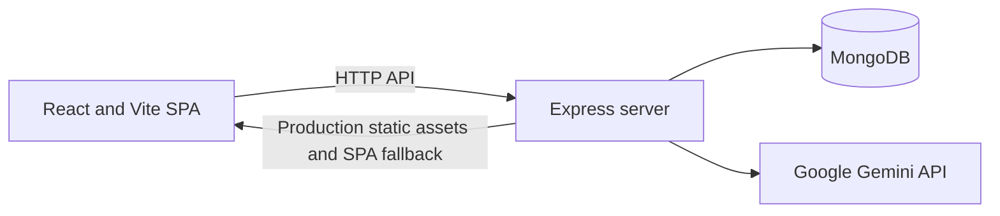

# PrepSense

PrepSense is a web app for interview practice and placement preparation.

**Live URL:** (https://prepsense-mhnn.onrender.com)

## Technology

- React 19, React Router 7, Vite 7, CSS
- Node.js 20+, Express 5, Mongoose 9, MongoDB
- Google Gemini API for question generation and written answer evaluation

## Features

- Written, multiple choice, and mixed practice sessions
- Session history, analytics, topic recommendations, company leaderboards, and public reports that owners can revoke
- Profile management, JSON export, account deactivation and permanent deletion
- Admin statistics for authorized admin accounts
- Resume analyzer information page links to the separate analyzer app

## Architecture

In production Express serves the built `dist/` app and routes non-API page requests to the SPA entry point.

## API endpoints

| Method | Endpoint | Access |
|---|---|---|
| POST | `/api/auth/register`, `/api/auth/login` | Public, rate limited |
| GET | `/api/auth/me`, `/api/auth/me/export` | Authenticated |
| PUT/PATCH | `/api/auth/me` | Authenticated |
| PUT | `/api/auth/me/password`, `/api/auth/me/deactivate` | Authenticated |
| POST | `/api/auth/me/delete` | Authenticated, password confirmation |
| POST/GET | `/api/sessions` | Authenticated |
| GET | `/api/sessions/:id` | Authenticated |
| DELETE | `/api/sessions/failed`, `/api/sessions/:id`, `/api/sessions/:id/empty` | Authenticated |
| POST/DELETE | `/api/sessions/:id/share` | Authenticated |
| POST | `/api/questions/generate` | Authenticated, rate limited |
| POST | `/api/answers/evaluate`, `/api/answers/:sessionId/:answerId/retry` | Authenticated, rate limited |
| GET | `/api/analytics/overview`, `/api/recommendations` | Authenticated |
| GET | `/api/companies/:name/insights` | Public |
| GET | `/api/leaderboard/:company` | Authenticated |
| GET | `/api/admin/stats` | Admin |
| GET | `/api/public/report/:token` | Public |
| GET | `/api/health` | Public |

## Environment variable names

Required: `MONGO_URI`, `JWT_SECRET` (at least 32 characters), `CLIENT_URL`, `GEMINI_API_KEY`.

Optional: `PORT`, `DNS_OVERRIDE`, `GEMINI_QUESTION_MODEL`, `GEMINI_EVAL_MODEL`, `GEMINI_TIMEOUT_MS`. See [.env.example](.env.example); keep secrets out of source control. `DNS_OVERRIDE=1` selects the configured Google DNS servers.

## Run locally

1. Install Node.js 20 or newer.
2. Run `npm ci`.
3. Copy `.env.example` to `.env` and set the required variables.
4. Run `npm run dev`. Express uses port 5000 and Vite uses port 5173.
5. Run `npm test` and `npm run build` for checks.

## Deploy to Render

Create a Node web service using the repository's `render.yaml`. The build command installs development dependencies and builds the Vite client; the start command is `npm start`. Configure the required variables in Render, setting `CLIENT_URL` to the browser app origin. Health check path: `/api/health`.

## Security notes

Passwords are stored as bcrypt hashes. Authenticated routes use JWTs; production startup validates required environment variables and JWT secret length. The API uses request validation, rate limits, and Helmet. Public shared reports expose a sanitized report and can be revoked. Use a dedicated MongoDB database user and restrict network access. Do not commit `.env` or publish secrets.

## Design system

The interface uses Space Grotesk and Manrope, with design tokens in `src/theme.css`. It supports dark and light themes and uses a signature gradient hero pattern for key summaries.
